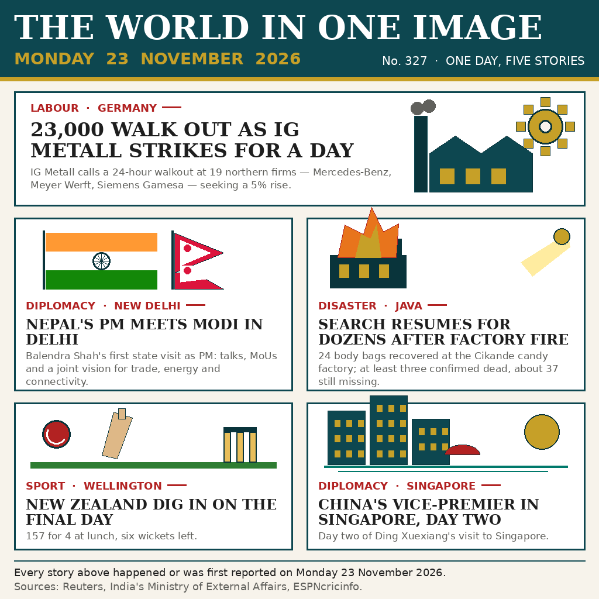

# The World in One Image — Monday 23 November 2026

[](https://make.fun/bounty/news-image-20261123?utm_source=github&utm_medium=readme&utm_campaign=news-image-20261123)
[](https://make.fun/bounty/news-image-20261123/leaderboard?utm_source=github&utm_medium=readme&utm_campaign=news-image-20261123)
[](https://make.fun/bounty/news-image-20261123?utm_source=github&utm_medium=readme&utm_campaign=news-image-20261123)

A one-image summary of the world's news of **Monday 23 November 2026**,
drawn as a newspaper front page: one lead story and four more, each with
a pictogram, a headline and a short deck.



## The five stories

1. **Labour · Germany** — IG Metall calls a 24-hour strike for Monday:
   about 23,000 workers at 19 firms in northern Germany — Mercedes-Benz,
   Meyer Werft, Siemens Gamesa — walk out in a pay dispute; the union
   wants a 5% rise.
2. **Diplomacy · New Delhi** — Nepal's prime minister Balendra Shah holds
   delegation-level talks with Narendra Modi on Monday, his first state
   visit as PM: MoUs and a joint vision for trade, energy and connectivity.
3. **Disaster · Java** — The search resumes on Monday morning for dozens
   still missing after the candy-factory fire in Cikande: 24 body bags
   recovered, at least three confirmed dead, about 37 unaccounted for.
4. **Sport · Wellington** — Final day of the first Test: New Zealand 157
   for 4 at lunch, six wickets left, battling to save the match after
   India's record 720 for 9 declared (Rahul 136, Pant 128).
5. **Diplomacy · Singapore** — China's vice-premier Ding Xuexiang spends
   the second day of his two-day visit in talks with Singapore's leaders.

Every story happened or was first reported on Monday 23 November 2026.
Facts verified against reporting by Reuters, India's Ministry of External
Affairs and ESPNcricinfo on 23 November 2026. Stories from 21–22 November
(the COP31 collapse, the US House result, the "El Chapo Isidro" capture,
the Sparta II fire, the Dymer strike) were checked and left out: they are
not this day's news.

## How to run it

`draw.py` renders the poster (Python 3 with Pillow and the system DejaVu
fonts, deterministic — no timestamps, no randomness, no network):

```sh
python3 draw.py   # writes entry.png, 1024x1024
```

`main.py` (Python 3.13, standard library only) copies the shipped
`entry.png` to the output directory:

```sh
mkdir -p out && MAKEFUN_OUTPUT_DIR=out python3 main.py
```

Running it twice produces byte-identical output.

## License

MIT — see [LICENSE](LICENSE).

---

Built for the [make.fun](https://make.fun/r/7nvvsk82) bounty
`news-image-20261123`. Try make.fun yourself:
https://make.fun/r/7nvvsk82
